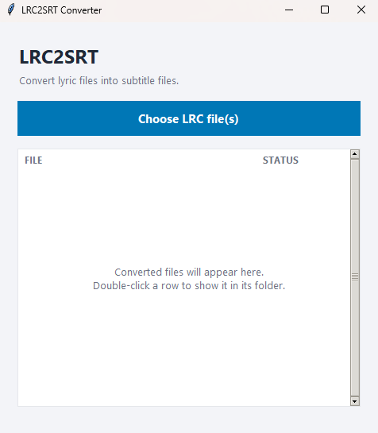

# LRC to SRT Converter

LRC to SRT Converter is a Python script that allows you to convert .lrc (Lyrics File) subtitle files to .srt (SubRip) format. This script automates the process of converting subtitles, making it easier to work with different subtitle formats.

but.. you've got an upgrade :D
its windowed now! forked from 

```
https://github.com/HUYDGD/lrc2srt
```

help with Ai in UI.

## Image



## Features

- Converts .lrc subtitle files to .srt format.
- Handles multiple .lrc files in a given directory.

## Requirements

- Python 3.x
tested in `python 3.10.6`

## Installation

1. Clone the repository to your local machine:

   ```bash
   git clone https://github.com/your-username/lrc2srt.git
   ```
2. make the app works as standalone for windows (for now)
you need to install :
   ```
   pip install pyinstaller
   ```
   then run these
   ```
   pyinstaller -F --noconsole lrc2srt.py
   ```
3. open the dist folder and the apps is there then you ready to go.